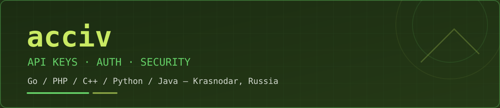

  

  

  
  

## 🧭 About Me

- 🔐 API keys are my thing — issuance, rotation, access control and keeping them out of public repos.
- 🐹 Writing Go for fast, boring-in-production services and middleware.
- 🐘 PHP for pragmatic web integration and glue code.
- ⚙️ C++ / Java / Python depending on the task — low-level control, enterprise integrations, automation.
- 🌱 Always learning better ways to make key management simple and secure.
- 📍 Based in Krasnodar, Russia.

## 🛠️ Stack & Tools

&nbsp;&nbsp;
&nbsp;&nbsp;
&nbsp;&nbsp;
&nbsp;&nbsp;
&nbsp;&nbsp;
&nbsp;&nbsp;
&nbsp;&nbsp;
&nbsp;&nbsp;
&nbsp;&nbsp;
&nbsp;&nbsp;

## ⚡️ Stats

  
  

  

## 📈 Contributions Graph

  

  
    
  

