<!--
  Визуал профиля сделан руками: анимированные SVG в assets/, без JS и шаблонов.
  Генератор: tools/generate_assets.py
-->

  

  
  
  

 

  

  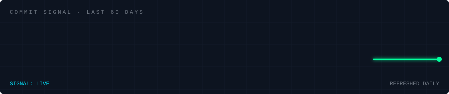

 

<h3 align="center"><code>[ KEY DISSECTION ]</code></h3>

  

 

<h3 align="center"><code>[ OBSESSIONS ]</code></h3>

  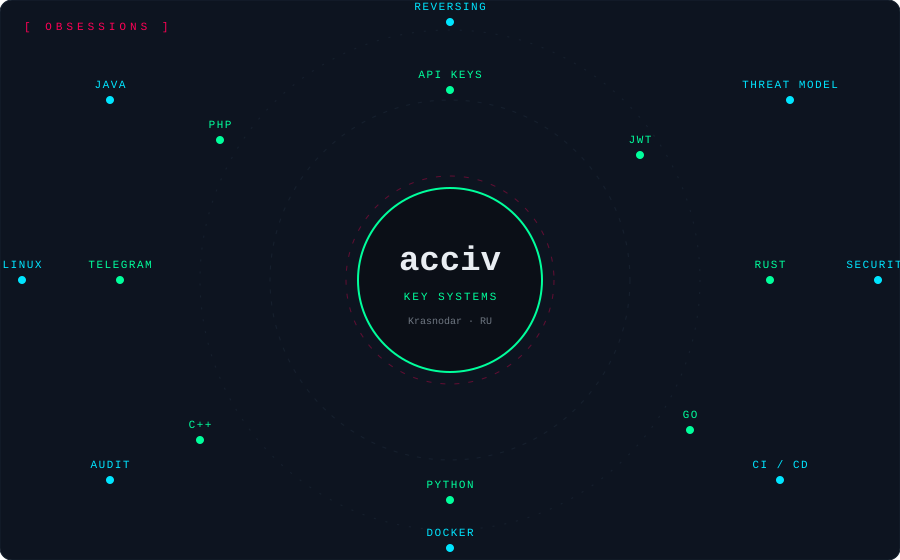

<h3 align="center"><code>[ CASE FILES ]</code></h3>

  <a href="https://github.com/acciv/keylens"></a>
  <a href="https://github.com/acciv/apixray"></a>
  <a href="https://github.com/acciv/keygate"></a>
  <a href="https://github.com/acciv/apishadow"></a>
  <a href="https://github.com/acciv/schema-registry"></a>

<h3 align="center"><code>[ BODY COUNT ]</code></h3>

  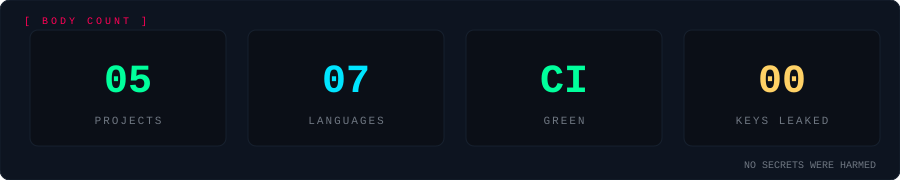
   
  

<h3 align="center"><code>[ ARSENAL ]</code></h3>

  
   
  

  
  
  
  
  

  

