<!--
  Профиль acciv в стиле https://github.com/LePhiAnhDev.
  Ассеты генерируются из tools/generate_assets.py и data/profile-stats.json.
  Никакого JS, только SVG + SMIL/CSS-анимации внутри файлов.
-->

  

  

  
  

<h3 align="center"><code>[ STACK ]</code></h3>

  <a href="https://www.rust-lang.org/"></a>
  
  <a href="https://www.python.org/"></a>
  <a href="https://isocpp.org/"></a>
  <a href="https://www.java.com/"></a>
  <a href="https://www.typescriptlang.org/"></a>
  <a href="https://core.telegram.org/bots/api"></a>
  <a href="https://www.php.net/"></a>
  <a href="https://en.wikipedia.org/wiki/C_ABI"></a>
  <a href="https://www.openapis.org/"></a>
  <a href="https://www.docker.com/"></a>

  

  

<h3 align="center"><code>[ PROJECTS ]</code></h3>

  <a href="https://github.com/acciv/keylens"></a>
  <a href="https://github.com/acciv/apixray"></a>

  <a href="https://github.com/acciv/keygate"></a>
  <a href="https://github.com/acciv/apishadow"></a>

  <a href="https://github.com/acciv/schema-registry"></a>
  <a href="https://github.com/acciv/apifuzz"></a>

  <a href="https://github.com/acciv/keygraph"></a>
  <a href="https://github.com/acciv/apicanon"></a>

  <a href="https://github.com/acciv/tgbotscope"></a>
  <a href="https://github.com/acciv/tgkeyhunt"></a>
  <a href="https://github.com/acciv/tgsecaudit"></a>
  <a href="https://github.com/acciv/dsrlab"></a>

<h3 align="center"><code>[ ARSENAL ]</code></h3>

  
  
  
  
  
  
  
  
  
  
  

  
  
  
  
  
  
  
  
  
  

  <a href="mailto:jumpscout@proton.me"></a>

